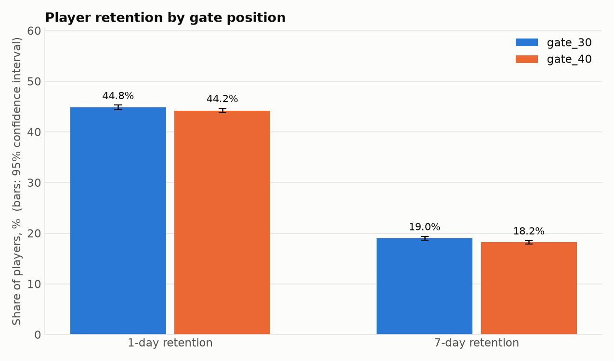
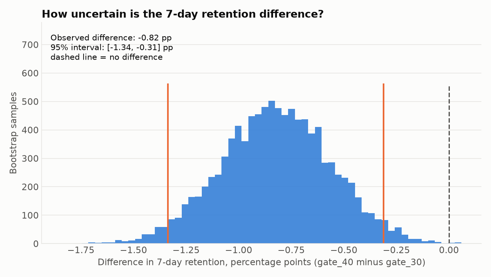

# Cookie Cats: A/B Test of Gate Placement

Statistical analysis of an A/B test in a mobile game: does moving the first "gate" (a forced pause) from level 30 to level 40 change player retention?

Built with Python (pandas, NumPy, SciPy, matplotlib).

## Background

In Cookie Cats, players hit "gates" that force them to wait or pay to continue. The company tested two versions:

- **gate_30** (control): the first gate at level 30
- **gate_40** (treatment): the first gate at level 40

## Dataset

[Mobile Games A/B Testing - Cookie Cats](https://www.kaggle.com/) (Kaggle): about 90,000 players, one row per player.

| Column | Meaning |
|---|---|
| `userid` | unique player id |
| `version` | test group (`gate_30` or `gate_40`) |
| `sum_gamerounds` | game rounds played in the first 14 days after install |
| `retention_1` | player came back 1 day after install |
| `retention_7` | player came back 7 days after install |

## Hypotheses and metrics (defined before looking at the results)

- **H0:** gate position does not change retention. **H1:** it does.
- **Primary metric:** 7-day retention, significance level 0.05.
- **Secondary metrics:** 1-day retention and game rounds, Bonferroni-corrected level 0.025 (two comparisons).
- All players are analyzed in the group they were assigned to.

## Methods

1. **Data checks:** duplicates, missing values, extreme values, players with zero rounds, and a **sample ratio check** (chi-square test that the group sizes match the 50/50 design).
2. **Two-proportion z-test** for retention, confidence interval for the difference, and a chi-square test as a cross-check.
3. **Bootstrap** interval for the difference in 7-day retention (10,000 resamples).
4. **Mann-Whitney U test** (and Welch t-test on capped values) for game rounds, because the distribution is very skewed.
5. **Power analysis:** the smallest effect the test can reliably detect and the sample size needed to detect 1 percentage point.

## Results

> Fill in after running `python ab_test_analysis.py` (the script prints ready-made sentences and saves them to `results/findings.txt`).

| Metric | gate_30 | gate_40 | Difference | p-value |
|---|---|---|---|---|
| 7-day retention (primary) | [X]% | [X]% | [X] pp | [X] |
| 1-day retention | [X]% | [X]% | [X] pp | [X] |
| Median game rounds | [X] | [X] | | [X] |




## Conclusion and recommendation

[Write 2-3 sentences: is the 7-day retention difference significant, what is its size and direction, and what should the company do. Copy the recommendation line from `results/findings.txt` and rewrite it in your own words.]

## Limitations

- Statistical significance is not the same as business importance: a tiny difference can be significant in a large sample, so the size of the effect (in percentage points) matters.
- Only retention and game rounds are available. Revenue, which is probably affected by gates, is not in the data.
- How players were assigned to groups is not documented. The sample ratio check helps spot problems, but it cannot prove the assignment was random.
- Only the first 14 days after install are covered.

## How to run

```bash
pip install -r requirements.txt
python get_data.py            # downloads the dataset from Kaggle into data/
python ab_test_analysis.py    # runs all tests, saves tables and charts
```

## Project structure

```
.
├── get_data.py            # downloads the dataset
├── ab_test_analysis.py    # data checks, tests, bootstrap, power, charts
├── results/               # test tables (CSV) and findings
├── images/                # charts
└── requirements.txt
```

## Author

[ISLAM ALIZHAN] [(https://www.linkedin.com/in/alizhan-islam-960790362)] | [alizhan1809@gmail.com]
